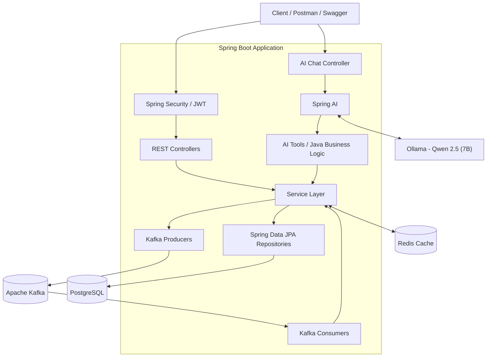

# IntelliStock AI — AI-Powered Inventory & Order Management System

A production-style backend learning project built using **Java 21 and Spring Boot**, featuring product management, warehouse inventory, order processing, Redis caching, Apache Kafka event-driven communication, and an AI-powered inventory assistant using Spring AI and Ollama.

The project focuses on practical backend engineering concepts, including REST API development, transaction management, inventory analysis, asynchronous event processing, and AI tool calling.

## 🚀 Key Features

### 📦 Product Management
- Create, retrieve, update, and delete products.
- Search products using product information.
- Manage product names, SKUs, descriptions, and prices.

### 🏭 Warehouse & Inventory Management
- Manage warehouses and product stock.
- Track inventory across warehouse locations.
- Reserve stock for customer orders.
- Validate available inventory before order processing.
- Handle insufficient-stock scenarios.

### 🛒 Order Management
- Create customer orders with multiple items.
- Calculate order totals.
- Manage order statuses.
- Reserve inventory during order processing.
- Use transactional business logic to maintain data consistency.

### 🤖 AI-Powered Inventory Assistant
Built with **Spring AI, Ollama, and Qwen 2.5 (7B)**.

The AI assistant interacts with existing Java application services through Spring AI tool calling.

Features include:
- **Product information lookup:** Retrieve product information such as name, SKU, description, and price.
- **Inventory replenishment recommendations:** Use existing Java business logic to help identify products that need replenishment.
- **At-risk inventory analysis:** Analyze inventory records using configured lead-time and safety-stock thresholds.
- **Natural-language interaction:** Ask inventory-related questions through the AI chat API.
- **Java tool integration:** Allow the AI model to invoke application-defined tools rather than relying only on information in the model.

**AI API endpoint:**

`POST /api/ai/chat`

**AI architecture:**

```text
User Question
     |
     v
Spring Boot AI Controller
     |
     v
Spring AI
     |
     v
Ollama - Qwen 2.5 (7B)
     |
     v
Tool Calling (@Tool)
     |
     v
Existing Java Services
     |
     v
Product / Inventory Data
     |
     v
AI-Generated Response
```

The AI assistant uses Java services to retrieve and analyze application data. Business calculations and inventory rules remain in the backend, helping keep inventory decisions grounded in actual application data.

### ⚡ Redis Caching
- Cache frequently accessed product data.
- Reduce repeated database queries.
- Configure Redis serialization and cache expiration.

### 📨 Apache Kafka
- Publish and consume application events.
- Explore asynchronous, event-driven communication.
- Work with Kafka topics, producers, consumers, and consumer groups.
- Configure retry and dead-letter topic handling.

### 🔐 Security
- Spring Security integration.
- Password hashing using BCrypt.
- Authentication development with login and registration APIs.
- JWT-based authentication integration.

### 📚 API Documentation
- Swagger UI and OpenAPI documentation.
- Test REST endpoints interactively.

### 🧪 Testing
- Unit tests for product, order, and inventory services.
- Practice testing business logic and service-layer behavior.

### 🐳 Containerization
- Docker-based local infrastructure for supporting services such as Kafka.

---

## 🛠️ Technology Stack

| Technology | Purpose |
|---|---|
| Java 21 | Backend programming |
| Spring Boot | Application framework |
| Spring MVC | REST API development |
| Spring AI | AI integration and tool calling |
| Ollama | Local AI model runtime |
| Qwen 2.5 (7B) | Language model |
| Spring Data JPA | Database access |
| Hibernate | Object-relational mapping |
| PostgreSQL | Relational database |
| Redis | Caching |
| Apache Kafka | Event-driven communication |
| Spring Security | Application security |
| JWT | Token-based authentication |
| Docker | Containerized infrastructure |
| Maven | Dependency management and builds |
| Swagger / OpenAPI | API documentation |
| JUnit / Mockito | Service-layer testing |
| Git / GitHub | Version control |

## 🏗️ Application Architecture

The Inventory & Order Management System follows a layered architecture built with Spring Boot. It integrates PostgreSQL for persistent storage, Redis for caching, Apache Kafka for event-driven communication, and Spring AI with Ollama for AI-powered inventory assistance.

### High-Level Architecture



### Component Responsibilities

| Component | Responsibility |
|---|---|
| REST Controllers | Receive HTTP requests and return responses |
| Spring Security / JWT | Protect endpoints and authenticate requests |
| Service Layer | Implement product, inventory, and order business logic |
| Spring Data JPA | Access and persist application data |
| PostgreSQL | Store products, warehouses, inventory, orders, and users |
| Redis | Cache selected frequently accessed data |
| Kafka | Support asynchronous event communication |
| Spring AI | Connect the chat endpoint to the language model and Java tools |
| Ollama | Run the configured local Qwen language model |

### Request Flow

**Normal REST API request**

```text
Client
  → Controller
  → Service
  → Repository
  → PostgreSQL
  → Response
```

**AI inventory request**

```text
User Question
  → AI Chat Controller
  → Spring AI
  → Ollama
  → Java Tool
  → Inventory / Product Service
  → Database
  → AI Response
```

**Event-driven processing**

```text
Business Operation
  → Kafka Producer
  → Kafka Topic
  → Kafka Consumer
  → Event Processing
```

These flows illustrate the intended architecture. Exact call paths depend on the implementation of each controller, service, AI tool, and Kafka consumer.


## 🗄️ Main Domain Modules

- **Product:** Product details, SKU, description, and price.
- **Warehouse:** Warehouse information and identification.
- **Inventory:** Stock quantities, reservations, and availability.
- **Order:** Customer orders, order items, totals, and statuses.
- **User:** User registration and authentication.
- **AI Assistant:** Natural-language access to selected inventory operations.

## 🔄 Transaction Management

Order processing uses Spring's transaction-management capabilities to help maintain consistency between order and inventory updates.

```java
@Transactional
public OrderResponse createOrder(...) {
    // Validate requested products
    // Check stock availability
    // Reserve inventory
    // Create and save the order
    // Return the order response
}
```

*Illustrative example; the actual method signature and implementation may differ.*

## ⚙️ Getting Started

### Prerequisites

Install and configure:

- JDK 21
- Maven
- PostgreSQL
- Redis
- Docker, where needed for Kafka infrastructure
- Ollama for local AI integration

### 1. Clone the repository

```bash
git clone https://github.com/Sapnnnaa/inventory-management-system.git
cd inventory-management-system
```

### 2. Configure PostgreSQL

Create the database:

```sql
CREATE DATABASE inventory_db;
```

Configure the database connection in `application.properties`:

```properties
spring.datasource.url=jdbc:postgresql://localhost:5432/inventory_db
spring.datasource.username=postgres
spring.datasource.password=${DB_PASSWORD}
```

Set `DB_PASSWORD` in your local environment or IntelliJ run configuration. Never commit real passwords or API secrets.

### 3. Start supporting services

Ensure PostgreSQL and Redis are running. Start Kafka using your local Docker configuration.

Default application connection addresses:

```text
PostgreSQL: localhost:5432
Redis:      localhost:6379
Kafka:      localhost:9092
```

### 4. Configure the AI model

Install Ollama and obtain the model:

```bash
ollama pull qwen2.5:7b
```

Start the Ollama service and ensure the Spring AI Ollama configuration points to the correct local endpoint and model.

### 5. Run the application

On Windows:

```powershell
.\mvnw.cmd spring-boot:run
```

Alternatively, run `InventoryManagementSystemApplication.java` from IntelliJ IDEA.

### 6. Open Swagger UI

After the application starts, visit:

http://localhost:8080/swagger-ui/index.html

Use the documented endpoints to explore and test the API.

## 🧪 Example API Endpoints

| Method | Endpoint | Purpose |
|---|---|---|
| GET | `/api/products` | Retrieve products |
| POST | `/api/products` | Create a product |
| GET | `/api/products/{id}` | Retrieve a product by ID |
| PUT | `/api/products/{id}` | Update a product |
| DELETE | `/api/products/{id}` | Delete a product |
| POST | `/api/auth/register` | Register a user |
| POST | `/api/auth/login` | Log in |
| POST | `/api/ai/chat` | Interact with the AI assistant |

Exact request formats and available operations can be verified in Swagger UI.

## 🎯 Engineering Concepts Demonstrated

- Object-oriented programming and dependency injection
- Layered application architecture
- REST API design
- Database relationships and constraints
- Transaction management
- Exception handling and validation
- Caching
- Event-driven architecture
- Unit testing
- Authentication and security
- AI tool calling and integration with Java business logic
- Local AI model deployment and integration

## 🔮 Potential Improvements

- Expand automated unit and integration test coverage.
- Add more AI tools for order analysis and operational insights.
- Add conversation memory and retrieval-augmented generation (RAG).
- Add application monitoring and centralized logging.
- Implement CI/CD and production deployment.
- Add more comprehensive security and authorization tests.

## 👩‍💻 Author

**Sapna Kumari**

Java Backend Developer

GitHub: https://github.com/Sapnnnaa

## 📌 Project Status

An evolving backend project focused on learning and implementing practical Java backend engineering, event-driven systems, and AI integration.
